# Random Walk and Interlacing Bee Optimization Algorithm, highly recommended! MATLAB code

This content and innovation points are sufficient to write a paper! Those interested in it, please download quickly to obtain the code. 
Detailed Explanation of Improvement Strategies:
① Piecewise Chaos Map for Initializing the Bee Swarm Population
Due to the random initialization of the basic bee search algorithm's population, it is impossible to ensure that individual positions are uniformly distributed within the search space, which affects the algorithm's search speed and optimization performance. In the improvement of the bee algorithm's initialization process, a Piecewise mapping was introduced to enhance the exploration capability of the initial population.
You can directly modify the first parameter of the chaos() function in the code, changing different chaos maps. A total of ten types of chaos maps are available for selection!
The principle of Piecewise mapping is as follows:
Chaos mapping is a method for generating chaotic sequences. Common methods of chaos mapping include Logistic mapping, Tent mapping, and Circle mapping. As a typical representative of chaos mapping, Piecewise mapping has a simple mathematical form and possesses both exploration and randomness. Piecewise chaos mapping is also known as PWLCM chaos mapping, and its description is as follows:
The principle of Piecewise mapping refers to the principle of using piecewise functions to describe an overall function. It divides the definition domain of the overall function into several subintervals and defines corresponding expressions on each subinterval. Thus, the overall function can be obtained by combining these subinterval expressions. The formula is as follows:
② Random Walk Strategy for Perturbing the Bee Ball Rolling Behavior
The random walk strategy formula is as follows:
Take a random function r(t) such as the one shown below:
Since the action trajectory of intelligent algorithms has a certain range, it cannot be directly used in the above formula to update the algorithm's position. To ensure that the algorithm walks within a certain range, normalization needs to be performed, as shown below.
The formula is as follows:
Xit = the position of the ith Dung Beetle at the tth iteration; αi and bi are the minimum and maximum values of the random walk variable in the ith dimension respectively; ci and di are the minimum and maximum values of the random walk variable in the ith dimension respectively at the tth iteration.
Random walk strategy references: Ma Xiaojing, He Hang, Wang Hongwei et al. A maximum entropy segmentation method based on improved sparrow search algorithm [J]. Science and Technology and Engineering, 2023, 23(16): 6983-6992.
③ The cross-crossover strategy perturbs the rolling ball behavior of Dung Beetle
The cross-crossover strategy is added at the end of the Dung Beetle algorithm to perturb the entire population of Dung Beetle. In order not to increase the complexity of the algorithm, a cross-crossover factor pv is introduced this time.
For more detailed explanations, the author has written a word for everyone to understand the program. The word and code have been packed together.
Results display
Tested on the CEC2005 function set and compared with the original Dung Beetle algorithm (DBO), sparrow algorithm (SSA), pelican algorithm (POA), subtraction optimizer algorithm (SABO), Harris hawk optimization algorithm (HHO). These algorithms are recommended by the author in previous articles, and their effects are very good!
And draw the function image, iteration curve, particle trajectory diagram, average convergence diagram and historical position diagram. These diagrams will be involved in many papers on intelligent algorithms.
F1:
F3:
F6:
F7:
F8:
F12:
F13:
F15:
Here are some pictures cut out, which can see that the test effect of the CEC2005 function is still very good.
Each algorithm is run 500 times, the number of Dung Beetle is set to 30, each function runs 30 times, and the optimal value, standard deviation, mean, median, worst value are five indicators as follows:
F1Function calculation results: \nSCDBO: Optimal value:0 Standard deviation:0 Mean:0 Median:0 Worst value:0\nDBO: Optimal value:1.0157e-173 Standard deviation:9.5433e-108 Mean:1.7424e-108 Median:1.0471e-138 Worst value:5.2271e-107\nPOA: Optimal value:1.6373e-119 Standard deviation:1.4619e-105 Mean:4.3103e-106 Median:1.8127e-111 Worst value:7.2434e-105\nSSA: Optimal value:0 Standard deviation:1.1972e-71 Mean:3.132e-72 Median:6.2763e-84 Worst value:5.3019e-71\nHHO: Optimal value:2.3021e-113 Standard deviation:4.2745e-97 Mean:7.8179e-98 Median:7.309e-106 Worst value:2.3414e-96\nSABO: Optimal value:5.3654e-205 Standard deviation:0 Mean:3.9743e-200 Median:3.4635e-201 Worst value:3.728e-199\nF2Function calculation results: \nSCDBO: Optimal value:0 Standard deviation:0 Mean:0 Median:0 Worst value:0\nDBO: Optimal value:1.9395e-82 Standard deviation:8.9231e-47 Mean:1.6387e-47 Median:7.4942e-66 Worst value:4.8883e-46\nPOA: Optimal value:7.6802e-60 Standard deviation:1.2828e-52 Mean:2.7947e-53 Median:9.2082e-57 Worst value:6.9708e-52\nSSA: Optimal value:2.6386e-105 Standard deviation:1.1085e-37 Mean:2.6762e-38 Median:1.9039e-43 Worst value:5.8943e-37\nHHO: Optimal value:1.6986e-63 Standard deviation:6.2275e-50 Mean:1.3802e-50 Median:5.4125e-54 Worst value:3.4129e-49\nSABO: Optimal value:2.9781e-111 Standard deviation:3.1509e-109 Mean:1.5485e-109 Median:3.653e-110 Worst value:1.2224e-108\nF3Function calculation results: \nSCDBO: Optimal value:0 Standard deviation:0 Mean:0 Median:0 Worst value:0\nDBO: Optimal value:7.9298e-140 Standard deviation:7.4087e-90 Mean:1.3526e-90 Median:1.43e-120 Worst value:4.0579e-89\nPOA: Optimal value:3.6236e-119 Standard deviation:2.5966e-102 Mean:5.8095e-103 Median:2.1491e-109 Worst value:1.4164e-101\nSSA: Optimal value:0 Standard deviation:7.303e-34 Mean:1.351e-34 Median:3.2315e-46 Worst value:4.0015e-33\nHHO: Optimal value:7.9145e-104 Standard deviation:1.4316e-83 Mean:2.6918e-84 Median:6.8701e-94 Worst value:7.8461e-83\nSABO: Optimal value:1.887e-124 Standard deviation:8.1132e-92 Average:1.5261e-92 Median:1.346e-101 Worst value:4.4465e-91\nF4Function calculation results: \nSCDBO: Optimal value:0 Standard deviation:0 Mean:0 Median:0 Worst value:0\nDBO: Optimal value:4.5839e-78 Standard deviation:2.1749e-53 Mean:4.1222e-54 Median:1.0567e-64 Worst value:1.192e-52\nPOA: Optimal value:3.8501e-60 Standard deviation:3.8074e-50 Mean:6.9934e-51 Median:1.8736e-55 Worst value:2.0858e-49\nSSA: Optimal value:0 Standard deviation:3.3535e-31 Mean:1.0817e-31 Median:1.1586e-42 Worst value:1.5018e-30\nHHO: Optimal value:2.4065e-58 Standard deviation:2.5452e-50 Mean:6.8289e-51 Median:5.6244e-53 Worst value:1.3738e-49\nSABO: Optimal value:2.0824e-86 Standard deviation:1.611e-84 Average:9.2585e-85 Median:1.8214e-85 Worst value:7.5793e-84\nF5Function calculation results: \nSCDBO: Optimal value:1.4161e-17 Standard deviation:1.3161e-06 Mean:3.8959e-07 Median:9.6891e-11 Worst value:6.9578e-06\nDBO: Optimal value:4.8681 Standard deviation:0.25742 Mean:5.2779 Median:5.2965 Worst value:6.0514\nPOA: Optimal value:5.5957 Standard deviation:0.6753 Mean:6.4188 Median:6.2743 Worst value:8.6983\nSSA: Optimal value:1.2568e-11 Standard deviation:1.3679e-05 Mean:8.3485e-06 Median:1.0955e-06 Worst value:5.9257e-05\nHHO: Optimal value:7.5118e-05 Standard deviation:0.0092594 Mean:0.0054348 Median:0.0013188 Worst value:0.034514\nSABO: Optimal value:6.9428 Standard deviation:0.57318 Average:7.7414 Median:7.5954 Worst value:8.932\nF6Function calculation results: \nSCDBO: Optimal value:0 Standard deviation:0 Mean:0 Median:0 Worst value:0\nDBO: Optimal value:1.6759e-28 Standard deviation:2.3742e-21 Mean:4.3682e-22 Median:7.7824e-26 Worst value:1.3007e-20\nPOA: Optimal value:1.426e-06 Standard deviation:0.16297 Mean:0.10968 Median:3.2748e-06 Worst value:0.50795\nSSA: Optimal value:0 Standard deviation:1.5483e-32 Mean:6.6766e-33 Median:0 Worst value:6.163e-32\nHHO: Optimal value:1.5768e-07 Standard deviation:9.2885e-05 Mean:5.1643e-05 Median:2.1108e-05 Worst value:0.00047807\nSABO: Optimal value:0.00082768 Standard deviation:0.11675 Mean:0.084462 Median:0.0028509 Worst value:0.31227\nF7Function calculation results: \nSCDBO: Optimal value:3.7485e-06 Standard deviation:6.6253e-05 Mean:9.042e-05 Median:7.261e-05 Worst value:0.00029542\nDBO: Optimal value:8.9047e-05 Standard deviation:0.00085674 Mean:0.0011393 Median:0.00097663 Worst value:0.003253\nPOA: Optimal value:2.7519e-05 Standard deviation:0.00010399 Mean:0.00018033 Median:0.00015875 Worst value:0.0004199\nSSA: Optimal value:0.00024343 Standard deviation:0.00065505 Mean:0.00097657 Median:0.00074117 Worst value:0.002631\nHHO: Optimal value:2.4419e-05 Standard deviation:0.00010443 Mean:0.00013761 Median:9.6844e-05 Worst value:0.00039128\nSABO: Optimal value:2.9006e-06 Standard deviation:8.5269e-05 Average:0.00013444 Median:0.00012065 Worst value:0.00036824\nF8Function calculation results: \nSCDBO: Optimal value:-4189.8289 Standard deviation:2.7751e-12 Mean:-4189.8289 Median:-4189.8289 Worst value:-4189.8289\nDBO: Optimal value:-4189.1149 Standard deviation:561.3868 Mean:-3403.3438 Median:-3318.4727 Worst value:-2524.1069\nPOA: Optimal value:-3495.3119 Standard deviation:190.811 Mean:-3105.8922 Median:-3078.9208 Worst value:-2783.9647\nSSA: Optimal value:-3834.5139 Standard deviation:297.1571 Mean:-3298.6531 Median:-3356.2094 Worst value:-2644.0623\nHHO: Optimal value:-4189.8288 Standard deviation:321.7061 Mean:-4107.747 Median:-4189.758 Worst value:-2502.2667\nSABO: Optimal value:-2404.9981 Standard deviation:212.2788 Mean:-1832.7709 Median:-1816.529 Worst value:-1477.79\nF9Function calculation results: \nSCDBO: Optimal value:0 Standard deviation:0 Mean:0 Median:0 Worst value:0\nDBO: Optimal value:0 Standard deviation:1.4532 Mean:0.26532 Median:0 Worst value:7.9597\nPOA: Optimal value:0 Standard deviation:0 Mean:0 Median:0 Worst value:0\nSSA: Optimal value:0 Standard deviation:0 Mean:0 Median:0 Worst value:0\nHHO: Optimal value:0 Standard deviation:0 Mean:0 Median:0 Worst value:0\nSABO: Optimal value:0 Standard deviation:0.3201 Mean:0.058442 Median:0 Worst value:1.7533\nF10Function calculation results: \nSCDBO: Optimal value:4.4409e-16 Standard deviation:0 Mean:4.4409e-16 Median:4.4409e-16 Worst value:4.4409e-16\nDBO: Optimal value:4.4409e-16 Standard deviation:6.4863e-16 Average:5.6251e-16 Median:4.4409e-16 Worst value:3.9968e-15\nPOA: Optimal value:4.4409e-16 Standard deviation:1.5283e-15 Mean:3.1678e-15 Median:3.9968e-15 Worst value:3.9968e-15\nSSA: Optimal value:4.4409e-16 Standard deviation:0 Mean:4.4409e-16 Median:4.4409e-16 Worst value:4.4409e-16\nHHO: Optimal value:4.4409e-16 Standard deviation:0 Mean:4.4409e-16 Median:4.4409e-16 Worst value:4.4409e-16\nSABO: Optimal value:4.4409e-16 Standard deviation:9.0135e-16 Mean:3.76e-15 Median:3.9968e-15 Worst value:3.9968e-15\nF11Function calculation results: \nSCDBO: Optimal value:0 Standard deviation:0 Mean:0 Median:0 Worst value:0\nDBO: Optimal value:0 Standard deviation:0.080687 Mean:0.02757 Median:0 Worst value:0.36647\nPOA: Optimal value:0 Standard deviation:0 Mean:0 Median:0 Worst value:0\nSSA: Optimal value:0 Standard deviation:0 Mean:0 Median:0 Worst value:0\nHHO: Optimal value:0 Standard deviation:0 Mean:0 Median:0 Worst value:0\nSABO: Optimal value:0 Standard deviation:0 Mean:0 Median:0 Worst value:0\nF12Function calculation results: \nSCDBO: Optimal value:4.7116e-32 Standard deviation:1.6702e-47 Mean:4.7116e-32 Median:4.7116e-32 Worst value:4.7116e-32\nDBO: Optimal value:6.4497e-30 Standard deviation:1.9233e-10 Mean:5.574e-11 Median:1.6706e-26 Worst value:9.4175e-10\nPOA: Optimal value:9.3878e-07 Standard deviation:0.056818 Mean:0.024918 Median:0.011793 Worst value:0.31105\nSSA: Optimal value:4.7116e-32 Standard deviation:1.1311e-33 Mean:4.7729e-32 Median:4.7116e-32 Worst value:5.2925e-32\nHHO: Optimal value:1.7419e-07 Standard deviation:3.674e-05 Mean:2.5912e-05 Median:8.5732e-06 Worst value:0.00014364\nSABO: Optimal value:0.00031832 Standard deviation:0.27689 Mean:0.11404 Median:0.035157 Worst value:1.4683\nF13Function calculation results: \nSCDBO: Optimal value:1.3498e-32 Standard deviation:5.5674e-48 Mean:1.3498e-32 Median:1.3498e-32 Worst value:1.3498e-32\nDBO: Optimal value:4.2384e-29 Standard deviation:0.034184 Mean:0.015678 Median:9.1549e-23 Worst value:0.15365\nPOA: Optimal value:1.3048e-05 Standard deviation:0.2442 Mean:0.32367 Median:0.29177 Worst value:0.83884\nSSA: Optimal value:1.3498e-32 Standard deviation:1.1736e-32 Mean:1.8387e-32 Median:1.3498e-32 Worst value:6.2802e-32\nHHO: Optimal value:1.4272e-06 Standard deviation:0.00010435 Mean:8.9774e-05 Median:3.828e-05 Worst value:0.00036751\nSABO: Optimal value:0.0021166 Standard deviation:0.17789 Mean:0.18365 Median:0.14352 Worst value:0.8822\nF14Function calculation results: \nSCDBO: Optimal value:0.998 Standard deviation:0 Mean:0.998 Median:0.998 Worst value:0.998\nDBO: Optimal value:0.998 Standard deviation:0.62117 Mean:1.2295 Median:0.998 Worst value:2.9821\nPOA: Optimal value:0.998 Standard deviation:0 Mean:0.998 Median:0.998 Worst value:0.998\nSSA: Optimal value:0.998 Standard deviation:5.4897 Average:5.283 Median:0.998 Worst value:12.6705\nHHO: Optimal value:0.998 Standard deviation:1.2607 Mean:1.4261 Median:0.998 Worst value:5.9288\nSABO: Optimal value:1.0038 Standard deviation:2.4805 Mean:3.749 Median:3.0453 Worst value:10.7664\nF15Function calculation results: \nSCDBO: Optimal value:0.00030749 Standard deviation:1.3372e-08 Mean:0.00030749 Median:0.00030749 Worst value:0.00030755\nDBO: Optimal value:0.00030749 Standard deviation:0.00031306 Mean:0.00068043 Median:0.00071924 Worst value:0.0012462\nPOA: Optimal value:0.00030749 Standard deviation:2.9636e-05 Mean:0.00031527 Median:0.00030749 Worst value:0.0004243\nSSA: Optimal value:0.00030749 Standard deviation:4.2456e-05 Mean:0.00032074 Median:0.00030749 Worst value:0.00049347\nHHO: Optimal value:0.00030762 Standard deviation:3.7868e-05 Mean:0.00034645 Median:0.0003325 Worst value:0.00043898\nSABO: Optimal value:0.00032613 Standard deviation:0.0011205 Mean:0.00084524 Median:0.00049202 Worst value:0.0062215\nF16Function calculation results: \nSCDBO: Optimal value:-1.0316 Standard deviation:6.2532e-16 Mean:-1.0316 Median:-1.0316 Worst value:-1.0316\nDBO: Optimal value:-1.0316 Standard deviation:6.1849e-16 Mean:-1.0316 Median:-1.0316 Worst value:-1.0316\nPOA: Optimal value:-1.0316 Standard deviation:5.6082e-16 Mean:-1.0316 Median:-1.0316 Worst value:-1.0316\nSSA: Optimal value:-1.0316 Standard deviation:5.2964e-16 Mean:-1.0316 Median:-1.0316 Worst value:-1.0316\nHHO: Optimal value:-1.0316 Standard deviation:2.8875e-10 Mean:-1.0316 Median:-1.0316 Worst value:-1.0316\nSABO: Optimal value:-1.0316 Standard deviation:0.032634 Average:-1.0142 Median:-1.029 Worst value:-0.90191\nF17Function calculation results: \nSCDBO: Optimal value:0.39789 Standard deviation:0 Mean:0.39789 Median:0.39789 Worst value:0.39789\nDBO: Optimal value:0.39789 Standard deviation:0 Mean:0.39789 Median:0.39789 Worst value:0.39789\nPOA: Optimal value:0.39789 Standard deviation:0 Mean:0.39789 Median:0.39789 Worst value:0.39789\nSSA: Optimal value:0.39789 Standard deviation:0 Mean:0.39789 Median:0.39789 Worst value:0.39789\nHHO: Optimal value:0.39789 Standard deviation:1.7605e-05 Mean:0.39789 Median:0.39789 Worst value:0.39797\nSABO: Optimal value:0.39789 Standard deviation:0.088128 Mean:0.44082 Median:0.40497 Worst value:0.84451\nF18Function calculation results: \nSCDBO: Optimal value:3 Standard deviation:1.6493e-15 Mean:3 Median:3 Worst value:3\nDBO: Optimal value:3 Standard deviation:3.1575e-15 Mean:3 Median:3 Worst value:3\nPOA: Optimal value:3 Standard deviation:1.3725e-15 Mean:3 Median:3 Worst value:3\nSSA: Optimal value:3 Standard deviation:4.9295 Average:3.9 Median:3 Worst value:30\nHHO: Optimal value:3 Standard deviation:1.251e-07 Mean:3 Median:3 Worst value:3\nSABO: Optimal value:3.002 Standard deviation:4.9135 Mean:5.0539 Median:3.1484 Worst value:24.3022\nF19Function calculation results: \nSCDBO: Optimal value:-3.8628 Standard deviation:2.6823e-15 Mean:-3.8628 Median:-3.8628 Worst value:-3.8628\nDBO: Optimal value:-3.8628 Standard deviation:0.0035449 Mean:-3.8607 Median:-3.8628 Worst value:-3.8549\nPOA: Optimal value:-3.8628 Standard deviation:2.4421e-15 Mean:-3.8628 Median:-3.8628 Worst value:-3.8628\nSSA: Optimal value:-3.8628 Standard deviation:2.3744e-15 Mean:-3.8628 Median:-3.8628 Worst value:-3.8628\nHHO: Optimal value:-3.8628 Standard deviation:0.0030906 Mean:-3.861 Median:-3.8619 Worst value:-3.8478\nSABO: Optimal value:-3.8347 Standard deviation:0.25214 Mean:-3.5928 Median:-3.6657 Worst value:-2.7088\nF20Function calculation results: \nSCDBO: Optimal value:-3.322 Standard deviation:2.5013e-15 Mean:-3.322 Median:-3.322 Worst value:-3.322\nDBO: Optimal value:-3.322 Standard deviation:0.087336 Mean:-3.2215 Median:-3.2031 Worst value:-3.0336\nPOA: Optimal value:-3.322 Standard deviation:0.036637 Mean:-3.31 Median:-3.322 Worst value:-3.1997\nSSA: Optimal value:-3.322 Standard deviation:0.059923 Mean:-3.2546 Median:-3.2031 Worst value:-3.2031\nHHO: Optimal value:-3.294 Standard deviation:0.095274 Mean:-3.1545 Median:-3.1732 Worst value:-2.8935\nSABO: Optimal value:-3.321 Standard deviation:0.10959 Mean:-3.2493 Median:-3.2972 Worst value:-2.7764\nF21Function calculation results: \nSCDBO: Optimal value:-10.1532 Standard deviation:6.0823e-15 Mean:-10.1532 Median:-10.1532 Worst value:-10.1532\nDBO: Optimal value:-10.1532 Standard deviation:2.5742 Mean:-7.7822 Median:-10.1338 Worst value:-5.0552\nPOA: Optimal value:-10.1532 Standard deviation:2.074 Mean:-9.1335 Median:-10.1531 Worst value:-5.0552\nSSA: Optimal value:-10.1532 Standard deviation:2.5922 Mean:-7.6038 Median:-7.5985 Worst value:-5.0552\nHHO: Optimal value:-10.1237 Standard deviation:0.92599 Mean:-5.2209 Median:-5.0531 Worst value:-5.0412\nSABO: Optimal value:-5.0543 Standard deviation:0.32764 Mean:-4.9631 Median:-5.052 Worst value:-3.2748\nF22Function calculation results: \nSCDBO: Optimal value:-10.4029 Standard deviation:7.3759e-16 Mean:-10.4029 Median:-10.4029 Worst value:-10.4029\nDBO: Optimal value:-10.4029 Standard deviation:2.8133 Mean:-7.6683 Median:-7.7659 Worst value:-2.7519\nPOA: Optimal value:-10.4029 Standard deviation:1.3485 Mean:-10.0485 Median:-10.4029 Worst value:-5.0877\nSSA: Optimal value:-10.4029 Standard deviation:2.6044 Mean:-8.453 Median:-10.4029 Worst value:-5.0877\nHHO: Optimal value:-5.0876 Standard deviation:0.0054662 Mean:-5.0841 Median:-5.0859 Worst value:-5.0604\nSABO: Optimal value:-7.4442 Standard deviation:0.73888 Mean:-4.8202 Median:-5.071 Worst value:-3.4225\nF23Function calculation results: \nSCDBO: Optimal value:-10.5364 Standard deviation:1.3601e-15 Mean:-10.5364 Median:-10.5364 Worst value:-10.5364\nDBO: Optimal value:-10.5364 Standard deviation:3.0945 Mean:-8.1125 Median:-10.5319 Worst value:-2.4273\nPOA: Optimal value:-10.5364 Standard deviation:1.372 Mean:-10.1758 Median:-10.5364 Worst value:-5.1285\nSSA: Optimal value:-10.5364 Standard deviation:2.4324 Mean:-9.0943 Median:-10.5364 Worst value:-5.1285\nHHO: Optimal value:-10.2238 Standard deviation:0.93342 Mean:-5.285 Median:-5.126 Worst value:-4.9565\nSABO: Optimal value:-9.8062 Standard deviation:1.4345 Mean:-5.0613 Median:-5.0671 Worst value:-2.4711\nMetrics generated with a single clickexcelFunction  
This code includes a one-click function to generate statistical results for various algorithms and saves them in an Excel file. Each test function will include a rank sum test result, optimal value, standard deviation, and mean indicator statistical results. The screenshot is as follows:

The statistical results for the optimal value, standard deviation, mean, worst value, and median are as follows:

Rank sum test statistical results:

Code directory:

The code directory is as follows:

It contains a program for plotting (plotCEC2005_Main.m) and a program for generating statistical indicators and saving them in an Excel file (runsCEC2005_Main.m). After running it, a table will be directly generated, where result.xls is the optimal value, standard deviation, mean indicator statistical results, and ranksumresult.xls is the rank sum test result.

Some code snippets are shown below:

## Images

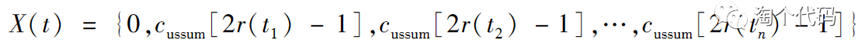

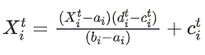

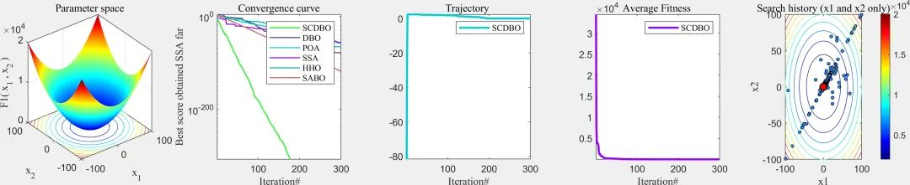
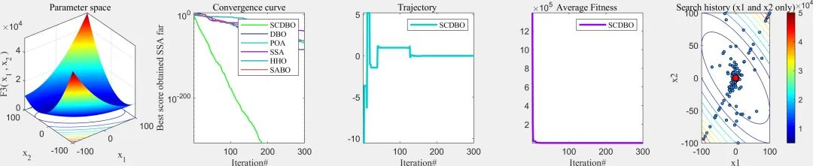
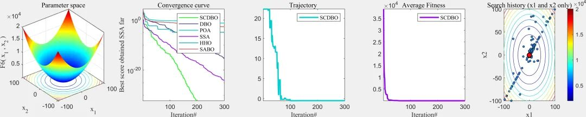
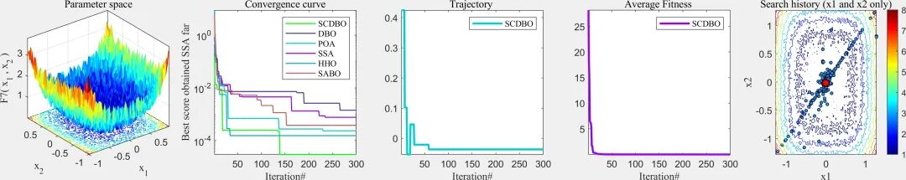
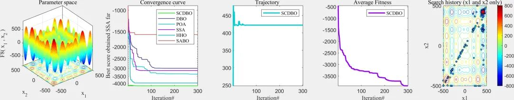
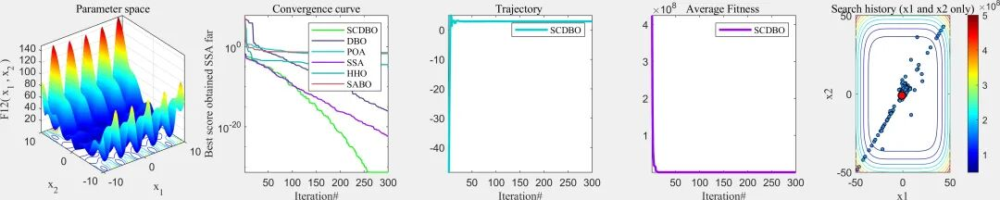
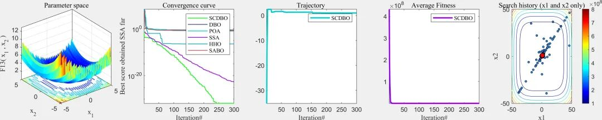
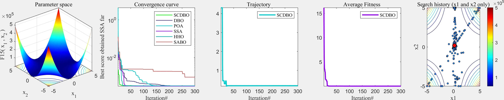
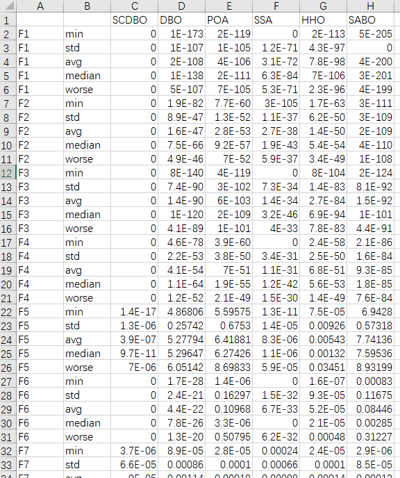
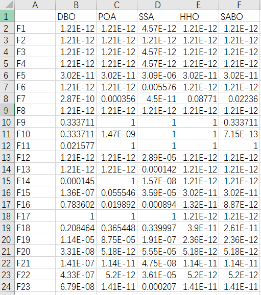
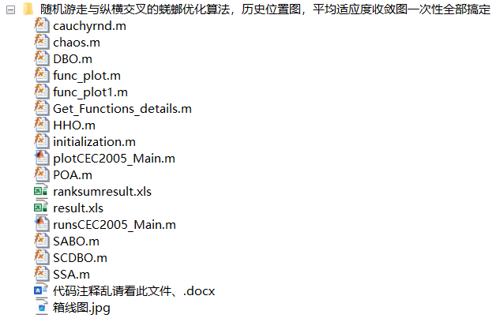

<!-- PAYMENT_BLOCK -->

## Get this dataset

- Payment link (Stripe): [Buy now](https://buy.stripe.com/3cs8yP7sY87d0vu9AB)
- Payment QR code: 

<!-- /PAYMENT_BLOCK -->
